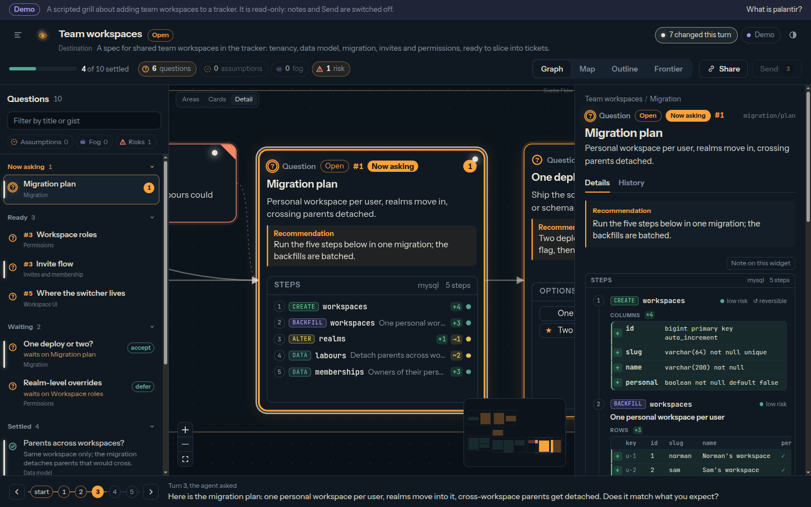
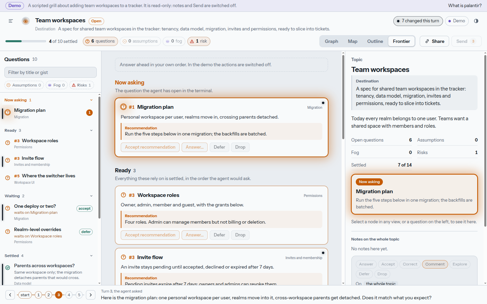
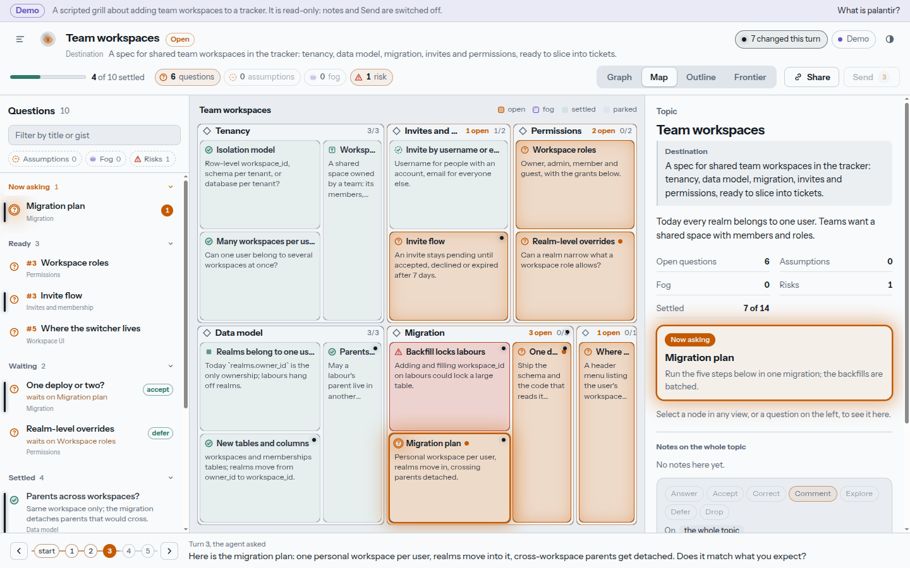

# speculum

See the grill.

speculum is a live, zoomable board of a grilling agent's model of a design. While an agent interviews you about a plan, it charts what it understands: areas, decisions, facts, assumptions, fog it can't yet phrase, risks, and widgets for the concrete shapes (table schemas, migration plans with row-level changes, files touched, class diagrams, flows, state machines, endpoint lists). Every open question is on the board with the agent's recommended answer, so you can answer them ahead, in your own order, instead of one at a time in the agent's. Your notes, pinned to a node or to one column, row or file, flow back into the agent's next turn.



## Features

- **The agent's model, not a transcript.** A tree of nodes with kinds and statuses; unknowns (open questions, assumptions, fog, risks) glow, settled ground recedes.
- **Zoom for detail.** Zoomed out you see areas with their counts; closer, cards with gists; closest, recommendations and widget previews. The agent keeps each level's summary current.
- **Questions sidebar.** Every question the agent knows about, grouped as Now asking, Ready, Waiting, Parked and Settled. Click one to fly to it.
- **Four views.** Graph, a treemap Map of where the unknowns cluster, an Outline, and a Frontier for answering ahead.
- **Eleven widgets** with addressable elements: schema, migration, files, classes, options, sequence, states, api, table, code, markdown. Proposals mark what they add, remove or change.
- **Notes flow back.** Answer, accept a recommendation, correct, comment, ask the agent to explore, defer or drop. Press Send to wake the agent, or just keep talking in the terminal: the next turn picks them up.
- **Live.** Server-sent events; a reconnecting page replays what it missed.
- **Safe to share.** The plain link is read-only. Your private link carries a note key in its fragment, because notes go straight into the agent's context.



## Install

Needs Node.js 22+, pnpm 11 (`corepack enable`), and Docker with compose for the local board server.

```sh
git clone https://github.com/nvanderploeg/speculum
cd speculum
scripts/install.sh --with-server --hooks
speculum doctor
```

This builds the packages, links the `speculum` skill and CLI, registers the MCP server with Claude Code (and Codex if present), starts the board on <http://localhost:3270>, and adds the hooks that bring board notes into each turn. It is safe to re-run; `scripts/uninstall.sh` removes exactly what it added.

## Use it

Start a grill as usual (the `grilling` skill, or "grill me on…"). With the `speculum` skill installed the agent opens a board, prints your private link, and keeps the board current every turn. Try it without an agent: open `/demo` for a scripted five-turn grill, or play it into a live board:

```sh
node scripts/simulate.mjs
```



## Documentation

- [`docs/usage.md`](docs/usage.md): install flags, the grill loop, views, MCP tools, CLI, configuration, development.
- [`CONTEXT.md`](CONTEXT.md): the vocabulary.
- [`docs/api.md`](docs/api.md), [`docs/widgets.md`](docs/widgets.md), [`docs/client.md`](docs/client.md), [`docs/ui.md`](docs/ui.md): the HTTP, widget, client and board contracts.

## License

BSD 3-Clause. See [`LICENSE`](LICENSE).
